# PathFinder AI - System Architecture

| | |
|---|---|
| **Document** | System architecture, database schema and API integration |
| **Prepared by** | Şilan Aybek, System Architect (Member 5) |
| **Version** | 1.0 |
| **Date** | 9 November 2026 |
| **Related files** | `README.md` (setup), `docs/API.md` (frontend usage), `docs/diagrams/` (all diagrams) |

---

## Contents

1. [Purpose and scope](#1-purpose-and-scope)
2. [Architecture overview](#2-architecture-overview)
3. [System context](#3-system-context)
4. [Components and responsibilities](#4-components-and-responsibilities)
5. [The analyze-profile function](#5-the-analyze-profile-function)
6. [Database schema](#6-database-schema)
7. [API integration](#7-api-integration)
8. [Main flows (sequence diagrams)](#8-main-flows-sequence-diagrams)
9. [Deployment and configuration](#9-deployment-and-configuration)
10. [Security](#10-security)
11. [Quality attributes](#11-quality-attributes)
12. [Design decisions](#12-design-decisions)
13. [Limitations and future work](#13-limitations-and-future-work)
14. [Integration checklist](#14-integration-checklist)
15. [Diagram index](#15-diagram-index)

---

## 1. Purpose and scope

PathFinder AI helps university students and recent graduates choose a career direction.
The user answers a 20-question questionnaire. The system then:

- calculates a match score for 5 career fields,
- picks the top 3 fields,
- estimates the user's skill gaps for each of them, and
- gives a short personal explanation and a 6 / 9 / 12-month learning roadmap.

This document describes how the parts of the system fit together: the services we use,
the database schema, the API that the frontend calls, the request flows, deployment,
and security. It is the reference for the integration and testing phase.

**In scope:** backend services, database, API contracts, data flow, deployment.
**Out of scope:** visual design (Member 1), frontend page code (Member 2) and the details of the
recommendation model and questionnaire content (Member 4). These are only described where they
touch the architecture.

---

## 2. Architecture overview

We use a **Backend-as-a-Service** architecture built on **Supabase**. Instead of writing and hosting
our own server, we use the services Supabase gives us and add our own logic in one serverless function.

| Layer | Technology | What it does |
|---|---|---|
| Presentation | HTML, CSS, JavaScript + `supabase-js` | Pages, forms, questionnaire, results charts |
| Authentication | Supabase Auth | Sign up, log in, JWT session tokens |
| Data API | PostgREST (auto-generated by Supabase) | Read / write tables over REST |
| Business logic | Supabase Edge Function `analyze-profile` (Deno, TypeScript) | Scoring, skill gaps, AI calls, saving results |
| Data | PostgreSQL 15+ | 11 tables: content, user data, results |
| AI (optional) | Google Gemini API | Understands the Q20 sentence; writes explanation and roadmap |

Two ideas shape the whole design:

1. **Simple things go straight to the database.** Loading questions, saving answers and reading
   past results are plain table operations, so the frontend uses the REST API directly.
   No custom code is needed for them.
2. **Anything that needs logic or secrets runs in the Edge Function.** Scoring and the Gemini
   key must not live in the browser, so they run on the server side in `analyze-profile`.

---

## 3. System context

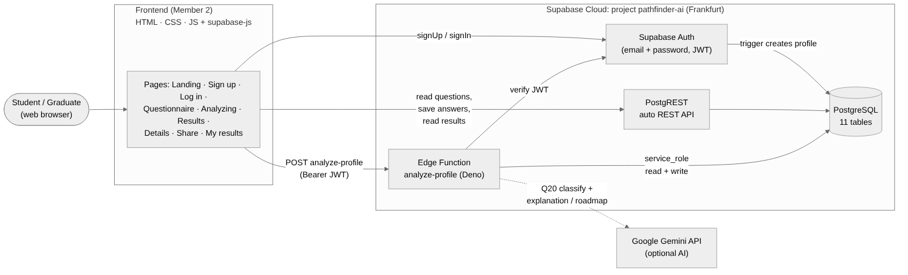

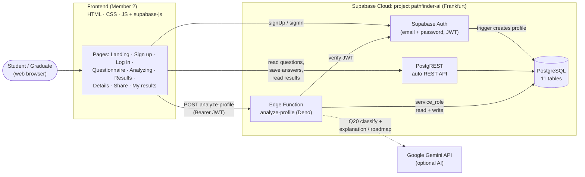

**External actors**

| Actor | Description |
|---|---|
| Student / graduate | Main user. Signs up, fills in the questionnaire, views and shares results. |
| Visitor | Anyone who opens a shared result link. Read-only. |
| Google Gemini | External AI service. Optional: the system keeps working without it. |

---

## 4. Components and responsibilities

| # | Component | Responsibility | Talks to | Source |
|---|---|---|---|---|
| C1 | Frontend | Shows pages, collects answers, calls Auth / REST / Function, draws the radar chart | C2, C3, C4 | frontend repo |
| C2 | Supabase Auth | Creates accounts, checks passwords, issues JWT access tokens | C5 (`auth.users`) | Supabase managed |
| C3 | PostgREST | Turns every table into a REST endpoint (`/rest/v1/<table>`) | C5 | Supabase managed |
| C4 | Edge Function `analyze-profile` | Validates answers, scores fields, estimates skill gaps, calls AI, stores the result | C2, C5, C6 | `supabase/functions/analyze-profile/` |
| C5 | PostgreSQL | Stores content, users, answers and results; trigger creates profiles | - | `supabase/migrations/`, `supabase/seed.sql` |
| C6 | Google Gemini | Classifies the free-text answer; writes personal text | - | external |

**Why the Edge Function uses the `service_role` key:** it has to read content tables and insert
into `results` / `result_details` on behalf of the user. It never trusts a user id sent by the
browser. It takes the id from the verified JWT (`auth.getUser(token)`), so a user can only create
results for themselves.

---

## 5. The analyze-profile function

### 5.1 Internal structure

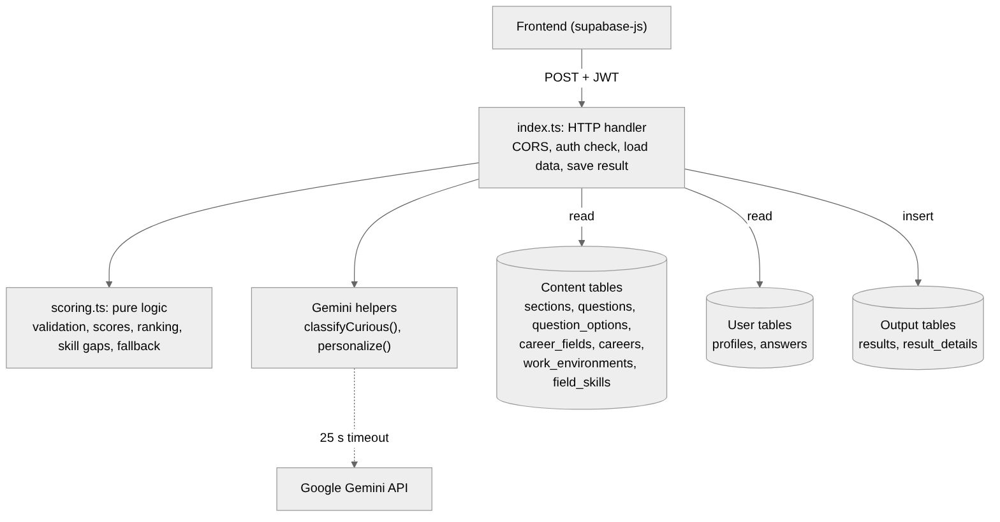

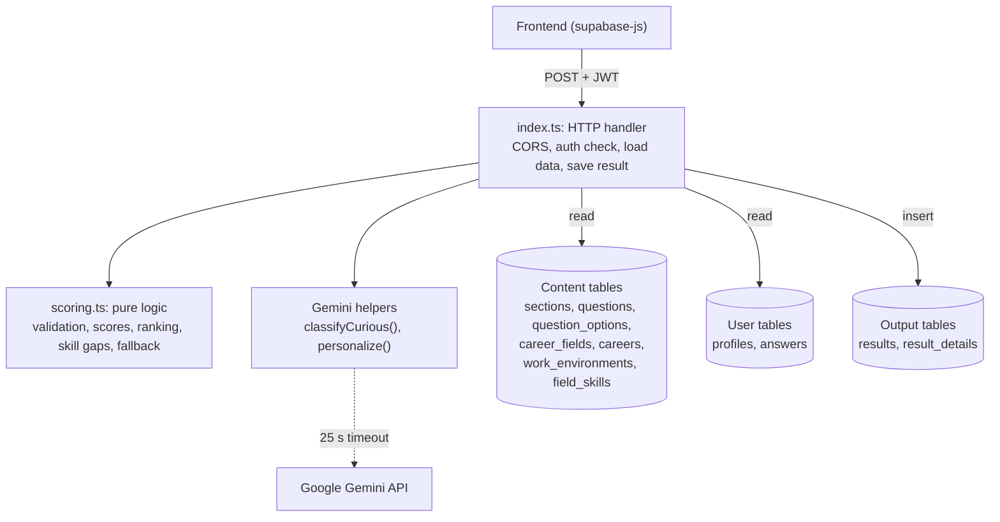

The code is split into two files on purpose:

- **`scoring.ts`** has only pure functions (no network, no database). They are easy to test and
  to explain in the presentation: `findMissingAnswers`, `computeScores`, `rankFields`,
  `estimateSkillGaps`, `fallbackRoadmap`, `describeAnswers`.
- **`index.ts`** does the input/output work: HTTP, authentication, database queries and the
  Gemini calls.

### 5.2 Processing pipeline

| Step | What happens | Code | On failure |
|---|---|---|---|
| 1 | Handle CORS preflight; accept only `POST` | `Deno.serve` | `405 Use POST` |
| 2 | Read `Authorization: Bearer <JWT>` and verify it | `db.auth.getUser(token)` | `401 Not logged in` |
| 3 | Load 6 datasets **in parallel**: questions, options, fields, field skills, careers, the user's answers | `Promise.all` | `500` |
| 4 | Check that every required question has a valid answer | `findMissingAnswers` | `400` + `missing_questions` |
| 5 | If Q20 has text, ask Gemini which field it points to | `classifyCurious` | treated as "no field" |
| 6 | Calculate 5 field scores (0-100) and sort them | `computeScores`, `rankFields` | - |
| 7 | Estimate 3 skill gaps for each of the top 3 fields | `estimateSkillGaps` | - |
| 8 | Ask Gemini for an explanation and a 6/9/12-month roadmap per field | `personalize` | fallback text |
| 9 | Insert 1 row in `results` and 3 rows in `result_details` | supabase-js | `500` |
| 10 | Return the full result as JSON | `json()` | - |

### 5.3 Scoring model (summary)

The recommendation logic is owned by the ML / AI Engineer (Member 4). The architecture only needs
to know that it is **deterministic** and **configurable**:

```
match % (per field) = 0.40 x interests (Q5-Q14)
                    + 0.30 x work style (Q15-Q17, Most = +1, Least = -1)
                    + 0.20 x related skill (Q3)
                    + 0.05 x field of study (Q1)
                    + 0.05 x curious-about sentence (Q20, via AI)

skill level = Q3 rating x 14  (+10 if the study field matches)  (+ experience bonus, max 15)
target      = 80 (stored per skill in field_skills.target)
```

- The weights live in one place: `WEIGHTS` in `scoring.ts`.
- Careers, key skills and targets live in the database (`seed.sql`), so they can be changed
  without touching code.
- The AI never changes the numbers. It only adds 5 % through Q20 and writes the text.
  The same answers always give the same scores.

---

## 6. Database schema

### 6.1 Entity-relationship diagram

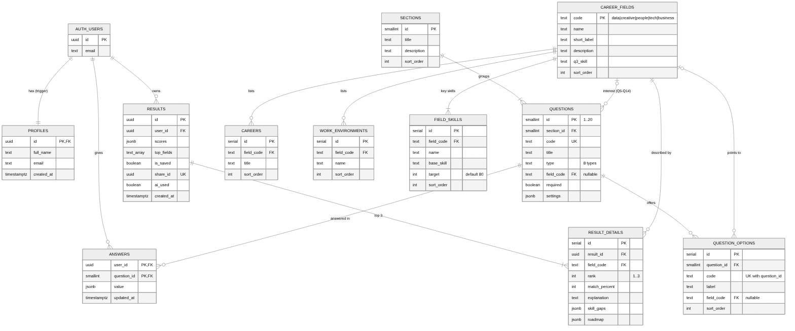

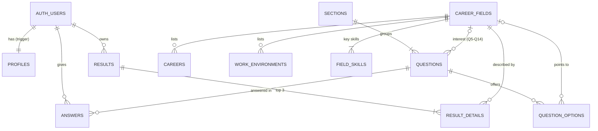

(The full diagram with every column is in `docs/diagrams/03-er-diagram.mmd` / `.png`.)

### 6.2 Table groups

The 11 tables fall into four groups. This grouping matters for security and for who is allowed
to change what.

| Group | Tables | Written by | Changes |
|---|---|---|---|
| **Identity** | `auth.users` (Supabase), `profiles` | Supabase Auth + trigger | on sign-up |
| **Content** (reference data) | `sections`, `questions`, `question_options`, `career_fields`, `careers`, `work_environments`, `field_skills` | `seed.sql` only | rarely, by the team |
| **User input** | `answers` | Frontend (REST) | on every "Next" |
| **Output** | `results`, `result_details` | Edge Function (insert), Frontend (`is_saved` update) | on every "See results" |

### 6.3 Tables

**profiles** - one row per user, created automatically by the `on_auth_user_created` trigger.

| Column | Type | Notes |
|---|---|---|
| `id` | uuid **PK**, FK -> `auth.users.id` | cascade delete |
| `full_name` | text | from `signUp(..., { data: { full_name } })` |
| `email` | text | copied from `auth.users` |
| `created_at` | timestamptz | default `now()` |

**sections** - the 4 questionnaire sections.

| Column | Type | Notes |
|---|---|---|
| `id` | smallint **PK** | 1-4 |
| `title`, `description` | text | shown on the intro page |
| `sort_order` | int | display order |

**questions** - the 20 questions.

| Column | Type | Notes |
|---|---|---|
| `id` | smallint **PK** | question number 1-20 |
| `section_id` | smallint FK -> `sections.id` | |
| `code` | text **unique** | e.g. `study_field` |
| `label`, `title`, `subtitle` | text | UI text |
| `type` | text, CHECK | `dropdown`, `single_choice`, `rating_grid`, `multi_select`, `scale`, `most_least`, `ranking`, `text` |
| `field_code` | text FK -> `career_fields.code`, nullable | only for interest questions Q5-Q14 |
| `required` | boolean | Q20 is `false` |
| `settings` | jsonb | e.g. `{"min":1,"max":5}`, `{"count":3}`, `{"max_length":300}` |

**question_options** - answer choices for every question that has them.

| Column | Type | Notes |
|---|---|---|
| `id` | serial **PK** | |
| `question_id` | smallint FK -> `questions.id` | cascade delete |
| `code` | text | value stored in `answers`; **unique with `question_id`** |
| `label` | text | text shown to the user |
| `field_code` | text FK -> `career_fields.code`, nullable | which field the option points to (Q1, Q3, Q15-Q17) |
| `sort_order` | int | |

**answers** - the user's answers, one row per user per question.

| Column | Type | Notes |
|---|---|---|
| `user_id` | uuid **PK**, FK -> `auth.users.id` | cascade delete |
| `question_id` | smallint **PK**, FK -> `questions.id` | |
| `value` | jsonb | format depends on question type (see 7.4) |
| `updated_at` | timestamptz | |

The composite primary key `(user_id, question_id)` is what makes "save on every Next" safe:
the frontend upserts, so answering the same question again overwrites the old answer.

**career_fields** - the 5 fields: `data`, `creative`, `people`, `tech`, `business`.

| Column | Type | Notes |
|---|---|---|
| `code` | text **PK** | |
| `name`, `short_label` | text | full name / radar chart label |
| `description` | text | used as fallback explanation |
| `q3_skill` | text | which Q3 skill belongs to the field |
| `sort_order` | int | |

**careers**, **work_environments** - lists shown on the "View details" page
(`id` serial PK, `field_code` FK, `title` / `name`, `sort_order`).

**field_skills** - 3 key skills per field, used for the skill gap.

| Column | Type | Notes |
|---|---|---|
| `id` | serial **PK** | |
| `field_code` | text FK | |
| `name` | text | e.g. "SQL & Excel" |
| `base_skill` | text | Q3 skill used to estimate the current level |
| `target` | int | default 80 |
| `sort_order` | int | |

**results** - one row each time the user clicks "See results".

| Column | Type | Notes |
|---|---|---|
| `id` | uuid **PK** | `gen_random_uuid()` |
| `user_id` | uuid FK -> `auth.users.id` | cascade delete |
| `scores` | jsonb | `{"data":73,"creative":62,...}` |
| `top_fields` | text[] | `["data","creative","people"]` |
| `is_saved` | boolean | "Save results" |
| `share_id` | uuid **unique** | public share link; separate from `id` so the internal id is never exposed |
| `ai_used` | boolean | `false` = fallback text |
| `created_at` | timestamptz | |

Index: `results_user_idx (user_id, created_at desc)` for the "My results" page.

**result_details** - 3 rows per result (one per top field).

| Column | Type | Notes |
|---|---|---|
| `id` | serial **PK** | |
| `result_id` | uuid FK -> `results.id` | cascade delete |
| `field_code` | text FK | **unique with `result_id`** |
| `rank` | int | 1, 2, 3 |
| `match_percent` | int | 0-100 |
| `explanation` | text | |
| `skill_gaps` | jsonb | `[{"skill":"...","current":45,"target":80}, ...]` |
| `roadmap` | jsonb | `[{"months":6,"step":"..."}, {"months":9,...}, {"months":12,...}]` |

### 6.4 Schema design notes

- **Content is data, not code.** Questions, options, careers and skills are rows. The scoring
  code finds things through `field_code` links, so we can rename careers or reword questions
  without a redeploy.
- **Codes instead of labels.** Answers store option `code`s (`"computer_science"`), never the
  displayed text. Changing a label does not break old answers.
- **`jsonb` for answers.** The 20 questions have 8 different answer shapes. One `jsonb` column
  is much simpler than 8 tables and still easy to query.
- **Results are snapshots.** A result copies scores, explanation and roadmap at the time it was
  created. If the content or the AI changes later, old results stay exactly as the user saw them.
- **Cascades.** Deleting a user deletes their profile, answers and results. Deleting a result
  deletes its details.
- **Re-runnable seed.** `seed.sql` truncates only the content tables and uses `on conflict ... do
  update`, so it can be run again at any time without touching users, answers or results.

---

## 7. API integration

All communication is HTTPS + JSON. The frontend uses the `supabase-js` client, which calls the
endpoints below. Every request carries the public `apikey` header; logged-in requests also carry
`Authorization: Bearer <access_token>` (supabase-js adds both automatically).

Base URL: `https://<project-ref>.supabase.co`

### 7.1 Endpoint catalogue

| # | Operation | supabase-js | HTTP | Auth |
|---|---|---|---|---|
| A1 | Sign up | `auth.signUp` | `POST /auth/v1/signup` | apikey |
| A2 | Log in | `auth.signInWithPassword` | `POST /auth/v1/token?grant_type=password` | apikey |
| A3 | Log out | `auth.signOut` | `POST /auth/v1/logout` | JWT |
| R1 | Get profile | `from("profiles").select()` | `GET /rest/v1/profiles?id=eq.<uid>` | JWT |
| R2 | Get sections | `from("sections").select()` | `GET /rest/v1/sections?order=sort_order` | apikey |
| R3 | Get questions + options | `from("questions").select("*, question_options(...)")` | `GET /rest/v1/questions?select=*,question_options(code,label,sort_order)&order=id` | apikey |
| R4 | Save an answer | `from("answers").upsert(..., {onConflict})` | `POST /rest/v1/answers?on_conflict=user_id,question_id` + `Prefer: resolution=merge-duplicates` | JWT |
| R5 | Load my answers | `from("answers").select().eq("user_id")` | `GET /rest/v1/answers?user_id=eq.<uid>` | JWT |
| F1 | **Analyze profile** | `functions.invoke("analyze-profile")` | `POST /functions/v1/analyze-profile` | **JWT required** |
| R6 | Field details | `from("career_fields").select("..., careers(...), work_environments(...)")` | `GET /rest/v1/career_fields?code=eq.<code>&select=...` | apikey |
| R7 | Result detail | `from("result_details").select()` | `GET /rest/v1/result_details?result_id=eq.<id>&field_code=eq.<code>` | JWT |
| R8 | Save result | `from("results").update({is_saved:true})` | `PATCH /rest/v1/results?id=eq.<id>` | JWT |
| R9 | Shared result | `from("results").select("..., result_details(*)").eq("share_id")` | `GET /rest/v1/results?share_id=eq.<id>&select=...` | apikey |
| R10 | My results | `from("results").select().eq("user_id").order("created_at")` | `GET /rest/v1/results?user_id=eq.<uid>&order=created_at.desc` | JWT |

Code examples for each call are in `docs/API.md`.

### 7.2 Page-to-API map

| Page | Calls |
|---|---|
| Landing | - |
| Sign up | A1 |
| Log in | A2 |
| Header (avatar initial) | R1 |
| Questionnaire intro | R2 |
| Questions 1-20 | R3 once, R5 to restore, R4 on every "Next" |
| Analyzing... | F1 |
| Results | response of F1 |
| View details | R6 + R7 (or the F1 response) |
| Save results | R8 |
| Share page | R9 |
| My results | R10 |

### 7.3 F1 - `analyze-profile` contract

**Request**

```http
POST /functions/v1/analyze-profile
Authorization: Bearer <access_token>
apikey: <public key>
Content-Type: application/json

(no body - the function reads the user's saved answers)
```

**Responses**

| Status | When | Body |
|---|---|---|
| `200` | success | full result (below) |
| `400` | required answers missing / invalid | `{"error":"Please answer all required questions","missing_questions":[3,15]}` |
| `401` | no token, expired or invalid token | `{"error":"Not logged in"}` |
| `405` | method is not POST | `{"error":"Use POST"}` |
| `500` | database or unexpected error | `{"error":"Something went wrong","details":"..."}` |

**200 body**

```json
{
  "result_id": "uuid",
  "share_id": "uuid",
  "created_at": "2026-11-04T15:00:00Z",
  "ai_used": true,
  "scores": [
    { "code": "data", "name": "Data / Research", "short_label": "Data", "score": 80 }
  ],
  "top_matches": [
    {
      "rank": 1,
      "code": "data",
      "name": "Data / Research",
      "match_percent": 80,
      "explanation": "You love finding patterns and answers in evidence.",
      "skill_gaps": [ { "skill": "SQL & Excel", "current": 50, "target": 80 } ],
      "roadmap": [
        { "months": 6,  "step": "..." },
        { "months": 9,  "step": "..." },
        { "months": 12, "step": "..." }
      ]
    }
  ]
}
```

Guarantees the frontend can rely on:

- `scores` always has **5** items, in `career_fields.sort_order` order.
- `top_matches` always has **3** items, sorted by `rank`.
- Each top match has exactly **3** `skill_gaps` and exactly **3** `roadmap` steps (6, 9, 12).
- All numbers are integers from 0 to 100.
- The response shape is the same whether `ai_used` is `true` or `false`.

### 7.4 Answer value format (`answers.value`)

This is the most important contract between the frontend and the backend. If a required answer
is missing or has the wrong shape, the function returns `400`. Numbers outside the allowed range
are clamped (for example a scale value of 7 is treated as 5), and the 300-character limit on Q20
is enforced by the frontend through `settings.max_length`.

| Question type | Questions | `value` example | Rule |
|---|---|---|---|
| `dropdown` | 1 | `"computer_science"` | one option code |
| `single_choice` | 2, 19 | `"recent_graduate"` | one option code |
| `rating_grid` | 3 | `{"communication":3,"analytical":4,"technical":3,"creativity":4,"leadership":2}` | non-empty object, values 1-5 |
| `multi_select` | 4 | `["internship","online_courses"]` | array (can be empty) |
| `scale` | 5-14 | `4` | number 1-5 |
| `most_least` | 15-17 | `{"most":["facts_data"],"least":["set_goals"]}` | at least 1 in each list |
| `ranking` | 18 | `["high_salary","job_stability","helping_others"]` | non-empty array, in order |
| `text` | 20 | `"I am curious about cyber security"` or `null` | optional, max 300 chars |

### 7.5 Error handling in the frontend

| Situation | Recommended UI |
|---|---|
| `signUp` error `User already registered` | show message under the email field |
| `401` from F1 | send the user to the log-in page |
| `400` from F1 | go back to the first question in `missing_questions` |
| `500` or network error | "Something went wrong, please try again" + retry button |
| F1 takes long | keep the "Analyzing..." screen; normal time is 3-10 s |

---

## 8. Main flows (sequence diagrams)

### 8.1 Sign up and questionnaire

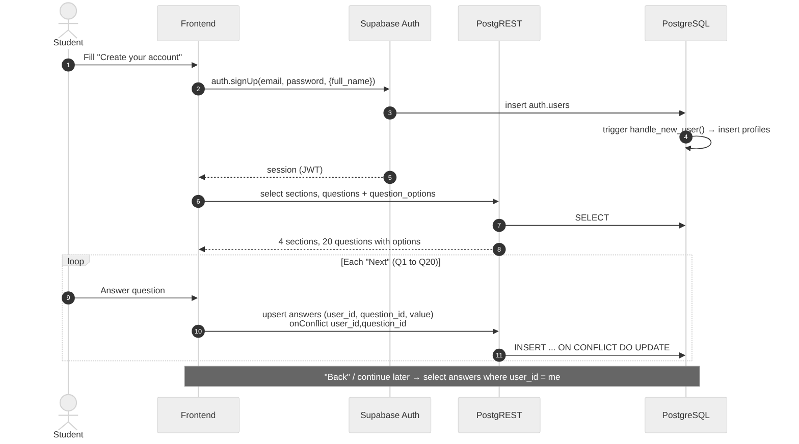

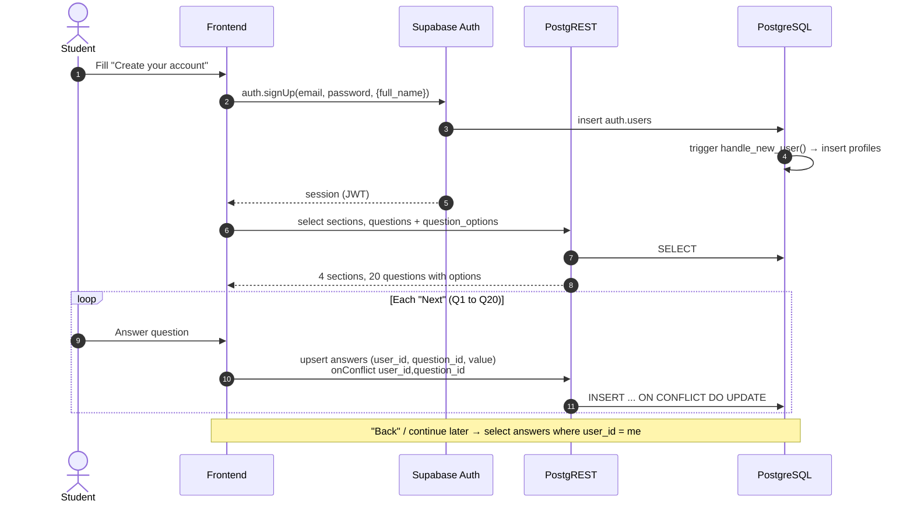

### 8.2 Analyze profile ("See results")

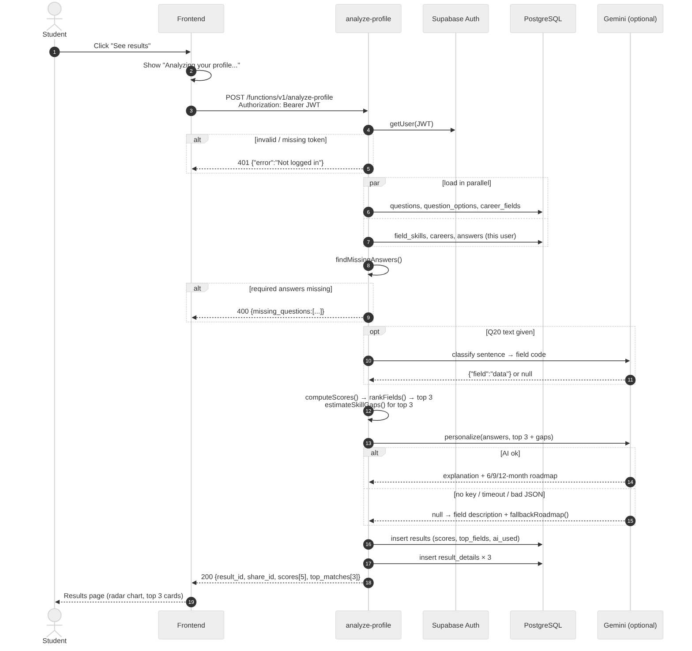

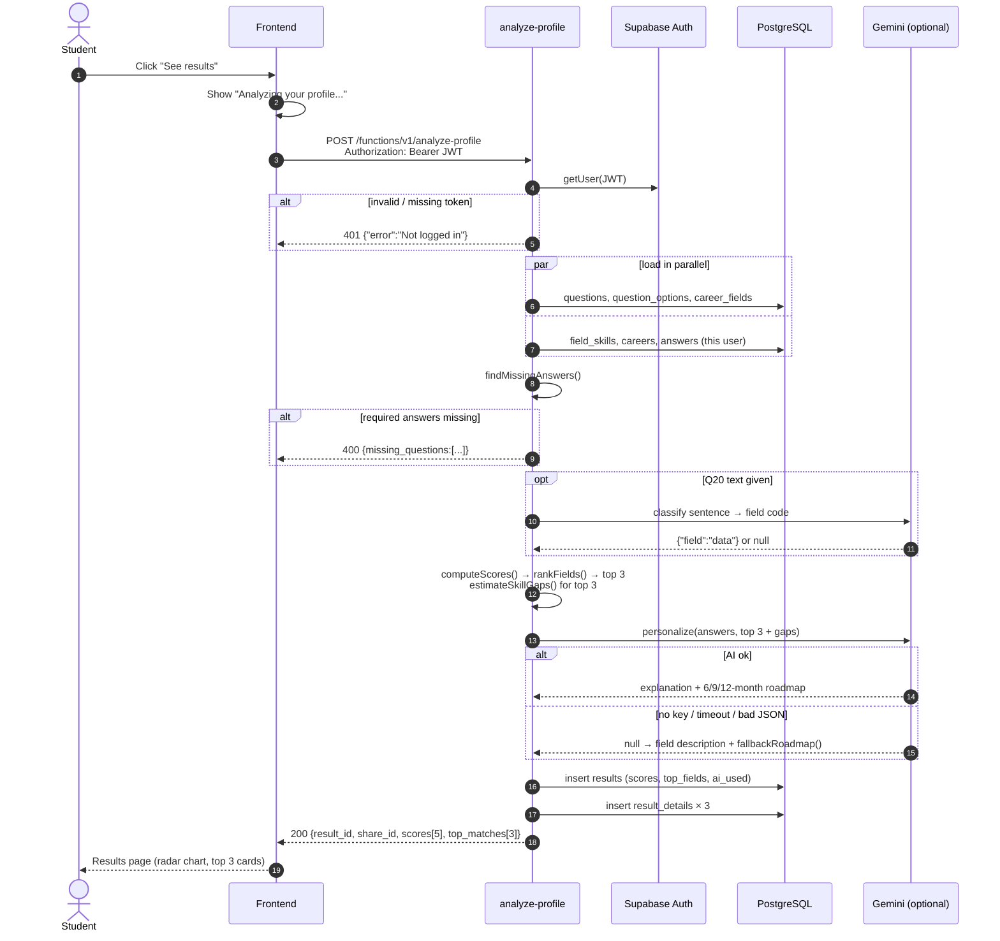

### 8.3 Details, save, share and history

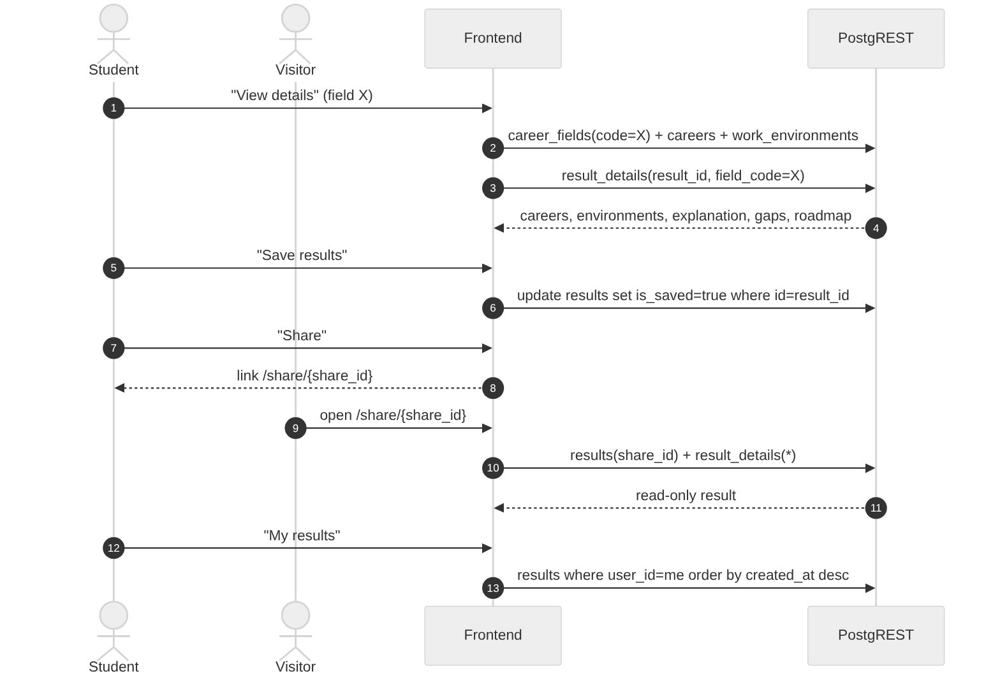

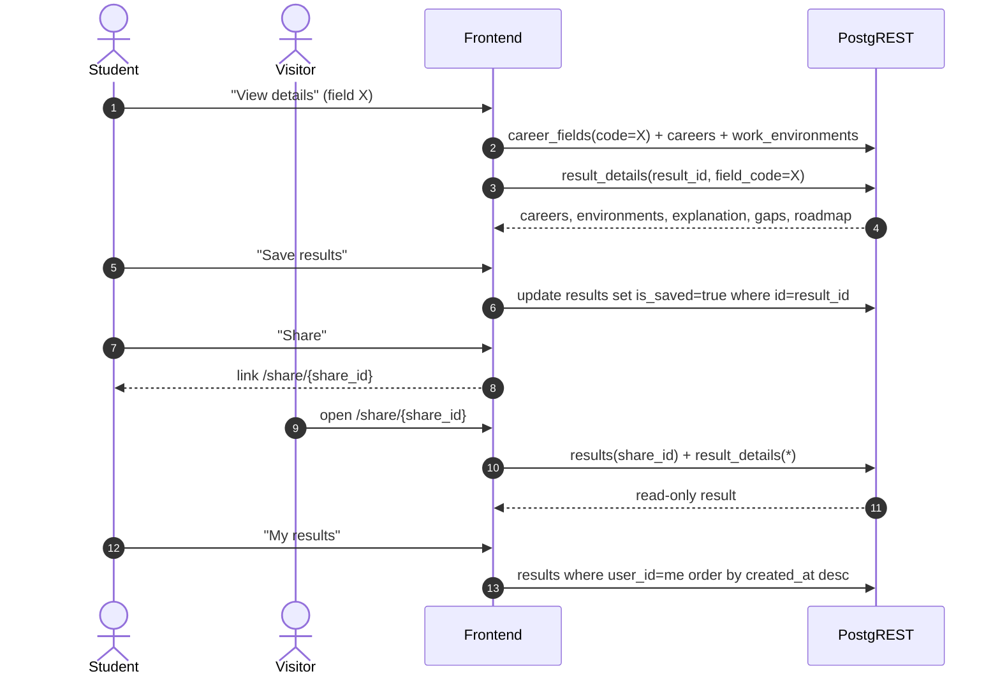

"Back to start" reuses flow 8.1: saved answers are loaded, the user changes what they want, and
"See results" creates a **new** result. Old results stay in the history.

---

## 9. Deployment and configuration

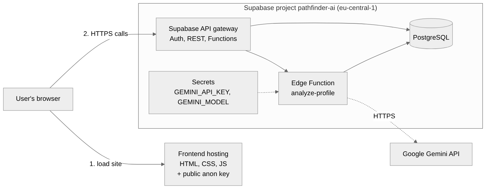

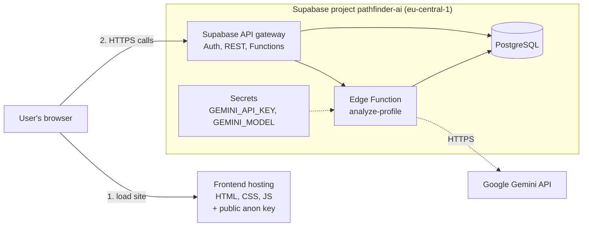

### 9.1 Environments

| Item | Value |
|---|---|
| Supabase project | `pathfinder-ai`, ref `cwlneejdcuuilfuwrfqz` |
| Region | eu-central-1 (Frankfurt) |
| Edge Function | `analyze-profile`, "Verify JWT" **off** (the function verifies the token itself) |
| Auth | Email + password, "Confirm email" **off** |

### 9.2 Configuration and secrets

| Name | Where | Required | Who can see it |
|---|---|---|---|
| Project URL | frontend config | yes | public |
| `anon` / publishable key | frontend config | yes | public (safe to ship) |
| `SUPABASE_URL` | Edge Function | yes, set automatically | server only |
| `SUPABASE_SERVICE_ROLE_KEY` | Edge Function | yes, set automatically | **server only, never share** |
| `GEMINI_API_KEY` | Edge Function secrets | no (AI off without it) | server only |
| `GEMINI_MODEL` | Edge Function secrets | no, default `gemini-flash-latest` | server only |

### 9.3 Deployment order

1. Run `supabase/migrations/20261104000001_schema.sql` (tables, trigger, grants).
2. Run `supabase/seed.sql` (sections, 20 questions, options, 5 fields, careers, skills).
3. Deploy the function: `supabase functions deploy analyze-profile` (or paste `index.ts` and
   `scoring.ts` in the dashboard editor).
4. Optional: add `GEMINI_API_KEY` under Edge Functions -> Secrets.
5. Give the frontend the project URL and the public key.
6. Smoke test with `supabase/tests/test_answers.sql` and the `curl` commands in `README.md`.

Steps 1 and 2 are idempotent, so they can be repeated safely.

---

## 10. Security

### 10.1 Current state (prototype)

| Area | Status |
|---|---|
| Passwords | Hashed and stored by Supabase Auth; never in our tables |
| Transport | HTTPS everywhere |
| Function identity | User id comes from the verified JWT, never from the request body |
| Secrets | Service role key and Gemini key exist only in the Edge Function environment |
| Prompt input | Q20 text is limited to 300 characters; the AI output is validated (shape, 3 steps, non-empty) before use |
| Row Level Security | **Off** (team decision for the prototype, see 12) |

### 10.2 Risk

With RLS off and `grant ... to anon, authenticated`, anyone who has the public key can read or
change **any** row through the REST API, including other users' answers, e-mails and results.
This is acceptable for a class demo with test accounts, but **must be fixed before real users**.

### 10.3 Recommended hardening (ready to apply)

The SQL below turns RLS on with the minimum policies the current frontend needs. The Edge
Function is not affected because the service role bypasses RLS.

```sql
-- Content tables: everyone can read, nobody can write through the API
alter table public.sections          enable row level security;
alter table public.questions         enable row level security;
alter table public.question_options  enable row level security;
alter table public.career_fields     enable row level security;
alter table public.careers           enable row level security;
alter table public.work_environments enable row level security;
alter table public.field_skills      enable row level security;

create policy "read content" on public.sections          for select using (true);
create policy "read content" on public.questions         for select using (true);
create policy "read content" on public.question_options  for select using (true);
create policy "read content" on public.career_fields     for select using (true);
create policy "read content" on public.careers           for select using (true);
create policy "read content" on public.work_environments for select using (true);
create policy "read content" on public.field_skills      for select using (true);

-- Own profile only
alter table public.profiles enable row level security;
create policy "own profile" on public.profiles
  for all using (id = auth.uid()) with check (id = auth.uid());

-- Own answers only
alter table public.answers enable row level security;
create policy "own answers" on public.answers
  for all using (user_id = auth.uid()) with check (user_id = auth.uid());

-- Results: read and update own; inserts only come from the Edge Function
alter table public.results enable row level security;
create policy "read own results"   on public.results for select using (user_id = auth.uid());
create policy "update own results" on public.results for update using (user_id = auth.uid());

alter table public.result_details enable row level security;
create policy "read own details" on public.result_details for select using (
  exists (select 1 from public.results r where r.id = result_id and r.user_id = auth.uid())
);

-- Share page: read one result by its share_id without opening the whole table
create or replace function public.get_shared_result(p_share_id uuid)
returns json
language sql
security definer
set search_path = public
as $$
  select json_build_object(
    'scores', r.scores,
    'top_fields', r.top_fields,
    'created_at', r.created_at,
    'result_details', coalesce(
      (select json_agg(d order by d.rank) from public.result_details d where d.result_id = r.id),
      '[]'::json)
  )
  from public.results r
  where r.share_id = p_share_id;
$$;
grant execute on function public.get_shared_result(uuid) to anon, authenticated;
```

If this is applied, the share page changes from `from("results")...eq("share_id", id)` to
`supabase.rpc("get_shared_result", { p_share_id: id })`. No other frontend change is needed.

---

## 11. Quality attributes

| Attribute | How the design supports it |
|---|---|
| **Availability** | AI is optional. If Gemini is missing, slow (>25 s) or returns bad JSON, the function uses fallback text and still returns a full result (`ai_used: false`). |
| **Performance** | Six database reads run in parallel. Normal response 3-10 s with AI, about 1 s without. Two Gemini calls run one after the other, so the worst case is about 50 s. |
| **Scalability** | Edge Functions scale automatically; the function is stateless. The database has an index for the heaviest user query (`results` by user and date). |
| **Maintainability** | Pure scoring logic separated from I/O; weights in one constant; content in the database; schema and seed are re-runnable scripts in Git. |
| **Testability** | `scoring.ts` can be unit-tested without a network; `tests/test_answers.sql` creates a full answer set for end-to-end testing. |
| **Consistency** | Scores are deterministic; results are stored as snapshots, so history and share links never change. |
| **Portability** | Standard PostgreSQL + TypeScript. The function can be moved to any Deno / Node host with small changes. |

---

## 12. Design decisions

| # | Decision | Alternatives considered | Reason |
|---|---|---|---|
| D1 | Supabase (BaaS) instead of a custom Node/Express server | Express + MongoDB; Firebase | Auth, database and REST API out of the box; SQL relations fit our data; free tier; less code to maintain for a 6-person team |
| D2 | PostgreSQL with relational content tables | NoSQL documents | Questions, options and fields are clearly related; foreign keys keep the data consistent |
| D3 | `jsonb` column for answers | one table per question type | 8 answer shapes; one table keeps saving and loading simple |
| D4 | Only one custom endpoint (`analyze-profile`) | endpoints for every action | Plain reads/writes are already covered by PostgREST |
| D5 | Rule-based scoring + AI only for text | Fully AI-generated recommendations | Explainable and repeatable scores; works without AI; cheaper and faster |
| D6 | Google Gemini | OpenAI, local model | Free API tier, JSON output mode, good quality for short text |
| D7 | Store results as snapshots | Recalculate on every view | Share links and history stay stable; no repeated AI cost |
| D8 | Separate `share_id` | Share with `results.id` | Internal ids are never exposed; a share link can be revoked later by changing only `share_id` |
| D9 | RLS off for the prototype | RLS from day one | Faster frontend integration during development; hardening script is ready (10.3) |
| D10 | "Verify JWT" off, token checked in code | Platform JWT check | Clear `401` messages and CORS preflight handled in one place |

---

## 13. Limitations and future work

| Limitation | Suggested improvement |
|---|---|
| RLS is off | Apply the script in 10.3 before going live |
| The two Gemini calls are sequential | Merge Q20 classification into the personalize prompt, or run them in parallel |
| No rate limiting on `analyze-profile` | Limit to e.g. 10 calls per user per hour (check `results.created_at`) |
| `results` and `result_details` inserts are not in one transaction | Move both inserts into a Postgres function so they succeed or fail together |
| No automated tests in CI | Add Deno unit tests for `scoring.ts` and a GitHub Actions workflow |
| English only | Add `language` to `profiles` and translated text columns or tables |
| Fixed 5 fields | The schema already supports more fields; only `FIELD_CODES` in `scoring.ts` needs updating |

---

## 14. Integration checklist

**Backend (database and function)**
- [ ] Schema and seed applied; `questions` = 20 rows, `career_fields` = 5 rows
- [ ] `analyze-profile` deployed; test user returns `200`
- [ ] Error cases tested: no token (`401`), missing answers (`400`), `GET` (`405`)
- [ ] `ai_used` checked with and without `GEMINI_API_KEY`

**Frontend**
- [ ] Project URL and public key configured (never the service role key)
- [ ] Every question type saves `value` exactly as in 7.4
- [ ] Answers are restored on "Back" and after a page reload
- [ ] Results page uses `scores` (5) and `top_matches` (3) from the F1 response
- [ ] Save, Share and My results work for a second, different user

**AI / recommendation**
- [ ] Weights and field skills agreed and updated in `scoring.ts` / `seed.sql`
- [ ] Gemini key added and responses checked for 3 different test profiles

**Before final demo**
- [ ] Decide on RLS (apply 10.3 or explain the prototype decision in the presentation)
- [ ] Architecture and ER diagrams added to the slide deck

---

## 15. Diagram index

All diagrams are in `docs/diagrams/`. Each one is available as `.mmd` (source, editable),
`.svg` (for documents) and `.png` (for slides).

| File | Shows | Section |
|---|---|---|
| `01-system-context` | Users, frontend, Supabase services, Gemini | 3 |
| `02-components` | Inside the `analyze-profile` function | 5.1 |
| `03-er-diagram` | All tables, columns and relations | 6.1 |
| `04-seq-signup-questionnaire` | Sign up and answering questions | 8.1 |
| `05-seq-analyze` | "See results" end to end | 8.2 |
| `06-seq-results` | Details, save, share, history | 8.3 |
| `07-deployment` | Hosting, Supabase project, secrets | 9 |

To edit a diagram, change the `.mmd` file and export it again, for example on
[mermaid.live](https://mermaid.live) or with the Mermaid CLI:

```bash
npx @mermaid-js/mermaid-cli -i docs/diagrams/05-seq-analyze.mmd -o docs/diagrams/05-seq-analyze.png -s 2 -b white
```
